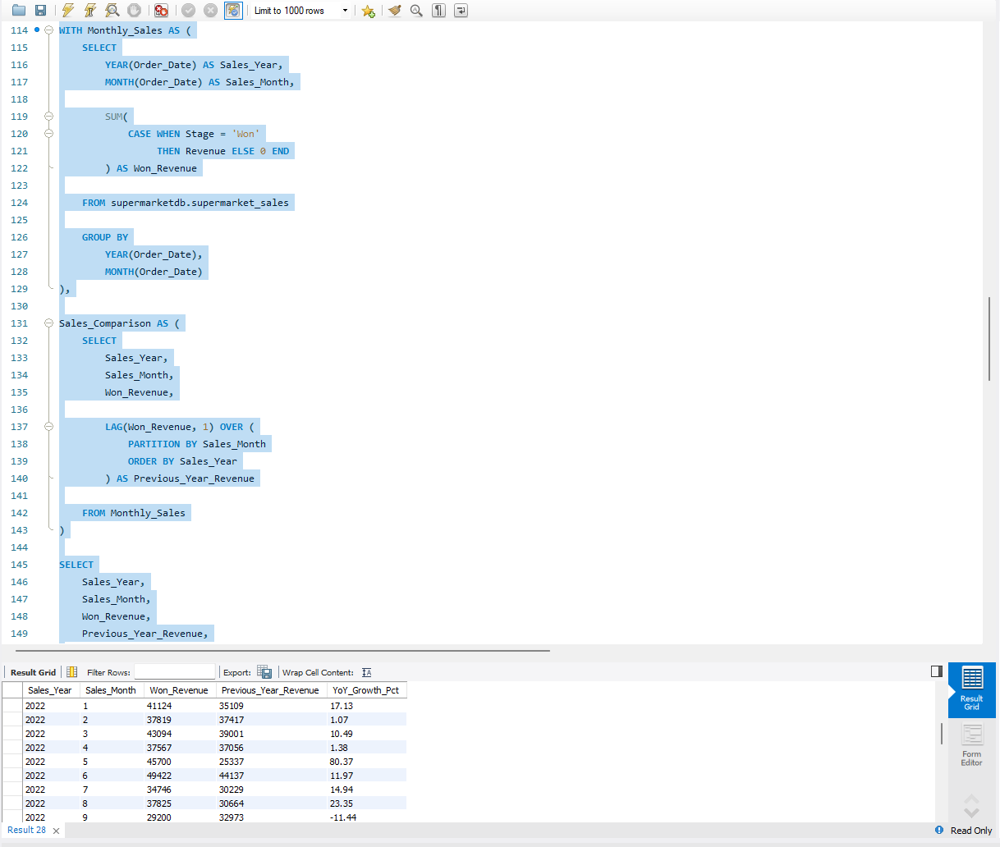
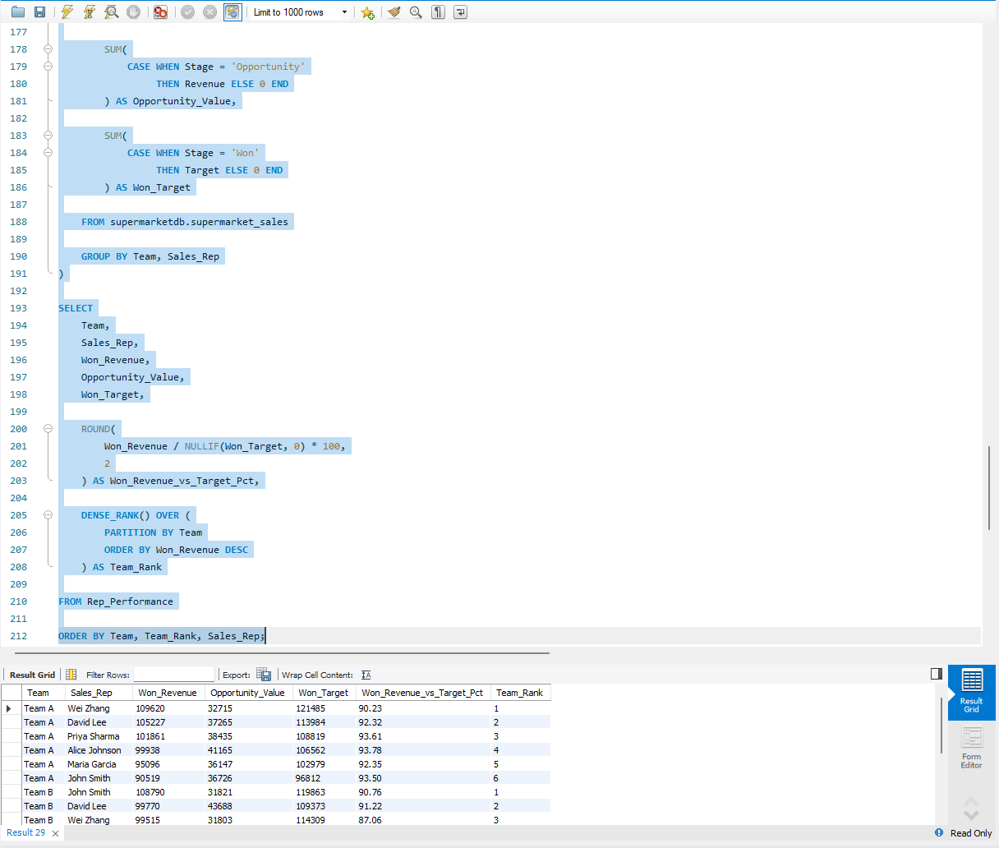
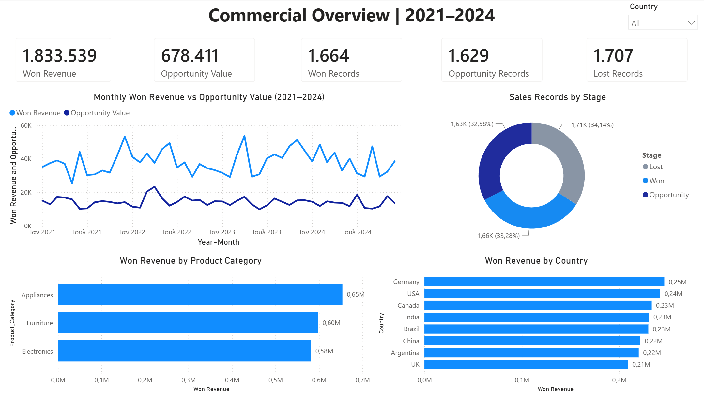
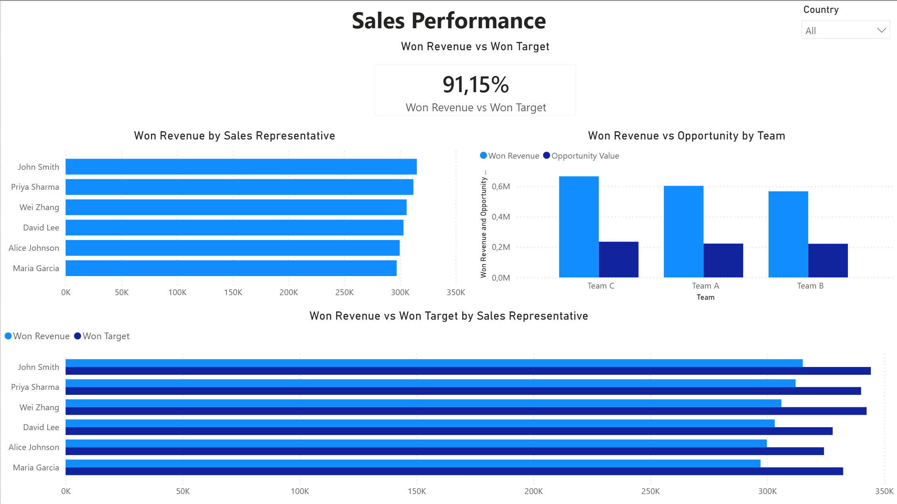
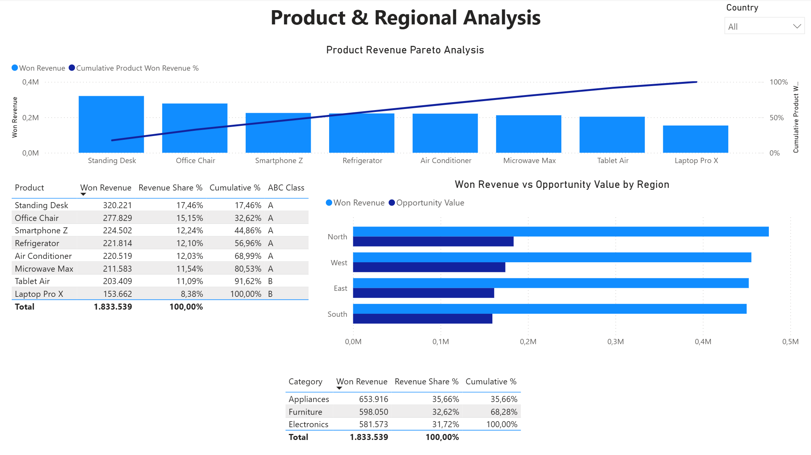

# Supermarket Sales Analysis | SQL & Power BI

## Project Overview

This project analyzes 5,000 supermarket sales records from 2021 to 2024 using MySQL and Power BI.

The main focus is on understanding sales performance, comparing actual revenue against targets, identifying trends over time, and examining how different products, regions, and sales representatives contribute to overall results.

An important part of the analysis is separating completed sales (`Won`) from potential sales (`Opportunity`). This prevents pipeline values from being included in actual revenue calculations.

I used SQL to explore the data and calculate performance metrics, then built a three-page Power BI report to present the results.

## Objectives

- Measure actual sales revenue and compare it with sales targets.
- Analyze sales opportunities and lost deals separately.
- Track monthly revenue trends and year-over-year changes.
- Compare sales representative and team performance.
- Identify the products and categories generating the most revenue.
- Examine sales performance across countries and regions.
- Present the findings in an interactive Power BI dashboard.

## Tools Used

- **MySQL:** Data exploration, aggregation, and analytical queries.
- **SQL:** CTEs, `CASE WHEN`, `GROUP BY`, `LAG()`, `DENSE_RANK()`, and `NULLIF()`.
- **Power BI:** Data modeling, DAX measures, KPI cards, charts, tables, and slicers.
- **Power Query:** CSV import and data type transformations.

## Dataset

The dataset contains 5,000 sales records covering the period from January 2021 to December 2024.

It includes information about order dates, sales representatives, teams, countries, regions, customer segments, products, revenue, and targets.

Each record belongs to one of three sales stages:

| Stage | Records |
|---|---:|
| Won | 1,664 |
| Opportunity | 1,629 |
| Lost | 1,707 |
| **Total** | **5,000** |

For this analysis:

- **Won Revenue** represents revenue from completed sales.
- **Opportunity Value** represents the value of potential sales.
- **Lost** records represent unsuccessful sales opportunities.

Keeping these stages separate was necessary to calculate meaningful sales KPIs.

## Key Metrics

| Metric | Value |
|---|---:|
| Won Revenue | 1,833,539 |
| Opportunity Value | 678,411 |
| Won Target | 2,011,623 |
| Won Revenue vs Target | 91.15% |
| Won Records | 1,664 |
| Opportunity Records | 1,629 |
| Lost Records | 1,707 |

The achieved revenue was approximately 91% of the target associated with completed sales.

## SQL Analysis

I used MySQL to calculate the main commercial metrics and explore performance across different dimensions.

The main SQL script includes queries for:

1. Sales stage distribution.
2. Overall commercial KPIs.
3. Monthly revenue and opportunity trends.
4. Year-over-year monthly revenue growth.
5. Sales representative ranking within each team.
6. Overall sales representative ranking.

### Year-over-Year Revenue Growth

To compare monthly performance with the previous year, I first aggregated Won Revenue by year and month using a CTE.

I then used `LAG()` with `PARTITION BY` to retrieve revenue from the same month of the previous year.

For example, Won Revenue increased from 35,109 in January 2021 to 41,124 in January 2022, a 17.13% increase.



### Sales Representative Ranking

I used `DENSE_RANK()` to rank sales representatives within each team based on Won Revenue.

The query also calculates Opportunity Value, Won Target, and target achievement percentage for each representative.

This makes it possible to compare performance both within individual teams and across the full sales dataset.



The complete queries are available in [commercial_performance_analysis.sql](./02_SQL/commercial_performance_analysis.sql).

## Power BI Report

I created a three-page Power BI report to explore the results.

The report uses a country slicer and separates completed sales from potential opportunities throughout the main visuals.

### Commercial Overview

The first page provides an overview of sales activity between 2021 and 2024.

It includes Won Revenue, Opportunity Value, record counts by stage, monthly trends, and revenue comparisons by product category and country.



### Sales Performance

The second page focuses on sales representatives, teams, and target achievement.

It compares Won Revenue against Won Target and shows how completed sales and opportunities are distributed across teams.



### Product & Regional Analysis

The third page examines product contribution and regional performance.

It includes a product-level Pareto chart, ABC classification, regional revenue comparisons, and product category revenue shares.



The Power BI files are available here:

- [Power BI report (.pbix)](./03_PowerBI/Supermarket_Sales_Analysis_Improved.pbix)
- [Dashboard PDF](./03_PowerBI/Supermarket_Sales_Analysis_Improved.pdf)

## Findings

### Sales Target Achievement

Total Won Revenue reached 1,833,539 against a Won Target of 2,011,623, resulting in a 91.15% achievement rate.

### Sales Opportunities

The dataset contains 678,411 in Opportunity Value. This amount is tracked separately because it does not represent completed sales.

### Product Performance

The six highest-revenue products account for approximately 80.53% of total Won Revenue.

Standing Desk generated the highest individual product revenue at 320,221, followed by Office Chair at 277,829.

### Product Categories

Appliances contributed the largest share of Won Revenue at 35.66%, followed by Furniture at 32.62% and Electronics at 31.72%.

### Sales Representatives

John Smith had the highest overall Won Revenue at 315,198.

The team-level ranking also showed differences in representative performance across the three sales teams.

## Project Structure

```text
Supermarket-Sales-Analysis-SQL/
|
|-- 01_Data/
|   |-- Source datasets
|
|-- 02_SQL/
|   |-- commercial_performance_analysis.sql
|   |-- Earlier SQL analysis scripts
|
|-- 03_PowerBI/
|   |-- Supermarket_Sales_Analysis_Improved.pbix
|   |-- Supermarket_Sales_Analysis_Improved.pdf
|
|-- 04_Screenshots/
|   |-- Commercial_Overview.png
|   |-- Sales_Performance.png
|   |-- Product_Regional_Analysis.png
|   |-- SQL_YoY_LAG_Analysis.png
|   |-- SQL_DENSE_RANK_Team_Performance.png
|
|-- README.md
```

## Data Source

The dataset was obtained from [SuperMarket Sales on Kaggle](https://www.kaggle.com/datasets/chadwambles/supermarket-sales/data).

License: CC0 (Public Domain).

## What I Learned

This project helped me practice writing SQL queries for business reporting and translating the results into a Power BI dashboard.

One of the main challenges was defining the revenue metrics correctly. Initially, the dataset contained values from different sales stages, so I had to separate completed sales from opportunities before calculating KPIs.

I also gained more experience using SQL window functions for time-based comparisons and sales representative rankings, as well as organizing multiple report pages around different business questions.
